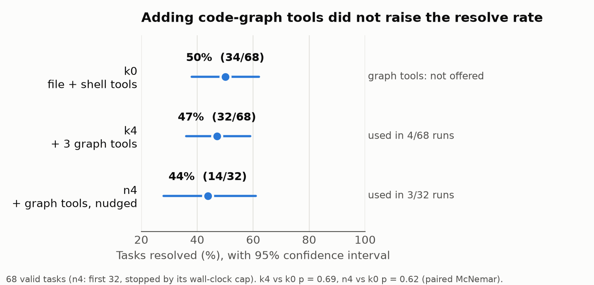
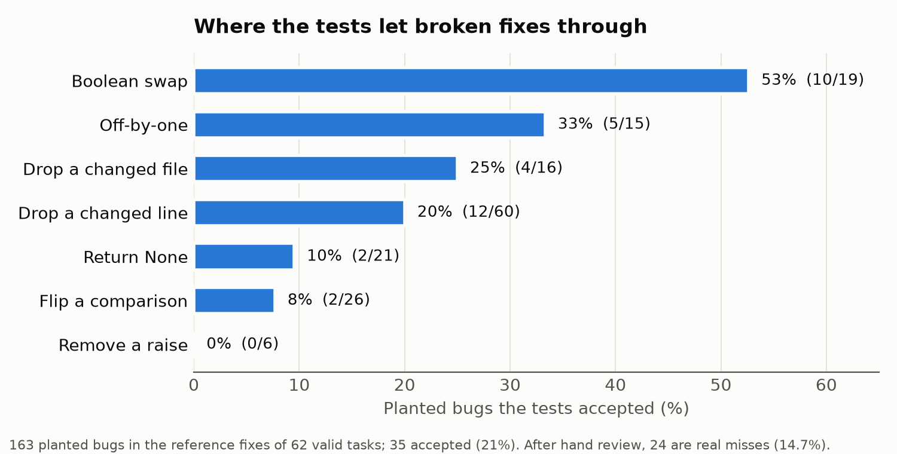

# Tools Unused, Tests Fooled

### What actually helps a Gemma 4 coding agent, and can we trust the score?

**Manohar Papasani** · [github.com/TechNaom/gemma4-agentic-swe](https://github.com/TechNaom/gemma4-agentic-swe)

*Draft v0.1, 2 November 2026. Every number links to a file in the repository.*

## Abstract

We ran `gemma-4-31b-it-qat-w4a16-ct`, the competition's 4-bit Gemma 4, as a software-engineering agent on the
public training tasks of the Gemma 4 Developer Agent competition, using the official harness on free Kaggle GPUs.
We asked two questions. **First, do the harness's code-graph tools help?** On all 68 tasks that can actually
separate a working agent from a broken one, the baseline agent with only file and shell tools resolved **50%**
(34/68); offering the three graph tools gave **47%** (32/68, paired McNemar p = 0.69), and nudging the agent to
use them gave **44%** (14/32, p = 0.62). The agent used a graph tool in fewer than 10% of runs unless told to,
and using them never helped. **Second, can the score be trusted?** An audit of all 129 tasks found that only
**68 (53%)** are valid in the provided environment, and planting known bugs into correct fixes showed that the
tests accept a genuinely broken fix in **24 of 163 cases (14.7%)**. We release the audit, the planted-bug set and
a record-and-replay toolkit so that agent scores on this benchmark can be checked rather than taken on trust.

## 1. Introduction

Coding agents built on large hosted models now fix a meaningful share of real GitHub issues. This competition
asks a harder, more practical question: how far can an open model that fits on a single node go? The harness
offers an obvious lever. Alongside the usual file and shell tools, it ships three **code-intelligence tools**
backed by precomputed call graphs and code embeddings. The intuition is appealing: an agent that can ask "who
calls this function?" or "where is code like this?" should localise a bug faster than one that greps.

We tested that intuition directly, and in doing so found a second problem that every leaderboard entry inherits:
part of the scoring signal is noise. Our contributions are:

1. **A controlled tool ablation (Study C).** Eleven agent configurations, two pilots and a full paired comparison
   on 68 tasks. Graph tools are rarely used when offered, and do not improve resolve rate when used.
2. **A benchmark validity audit.** Every public task verified with its reference fix and with no fix: 61 of 129
   cannot discriminate between agents in this environment, mostly because two test libraries are missing.
3. **A test-adequacy study (Study B).** 163 planted bugs across 7 mutation operators: 14.7% of broken fixes are
   accepted, so a fraction of any agent's "resolved" count may not be real.
4. **An open, reproducible resource (A).** Recorded runs, a replay-and-re-verify toolkit, and automation that
   collects every Kaggle run into versioned result files.

## 2. Setup

**Model and serving.** `gemma-4-31b-it-qat-w4a16-ct`, the only variant the harness supports, served with vLLM
on a Kaggle notebook with 4× NVIDIA L4 (96 GB). Two serving details mattered: the default concurrency
(`max-num-seqs 256`) runs out of memory for a 31B model and had to be lowered to 8, and the model's maximum
output of 16,384 tokens per turn caused context overflows against the 32,768-token window (Section 4.2).

**Harness and agent.** The official `swegemma` harness and a Google ADK agent configuration. The agent sees the
issue text and works in a sandboxed copy of the repository with six workspace tools (`run_command`,
`read_file`, `edit_file`, `write_file`, `get_status`, `submit_patch`) and, depending on configuration, the three
graph tools: `get_code_neighbors` (callers and callees), `search_similar_code` (embedding search) and
`get_code_subgraph` (induced call graph). Per task the budget is 15 minutes, 60 tool calls and 200 turns.

**Scoring.** As in SWE-bench: apply the agent's patch, reset test files, apply the task's test patch, run
`pytest`; a task is resolved if every target test passes.

**Tasks.** The 129 public training tasks (fastapi 67, rich 48, requests 13, httpx 1). The hidden test set was
never used.

## 3. Only 68 of 129 tasks can tell agents apart

Before measuring agents we measured the benchmark. Every task was verified twice with the official harness:
with its **reference ("gold") patch**, which should resolve, and with an **empty patch**, which should not.
A task can separate a working agent from a broken one only if both hold.

| Repo | Tasks | Gold resolves | Empty resolves | Valid |
|---|---|---|---|---|
| fastapi | 67 | 31 | 2 | 29 |
| rich | 48 | 39 | 0 | 39 |
| requests | 13 | 3 | 3 | 0 |
| httpx | 1 | 0 | 0 | 0 |
| **Total** | **129** | **73** | **5** | **68** |

*Source: [audit-2026-10-15/README.md](https://github.com/TechNaom/gemma4-agentic-swe/blob/main/experiments/audit-2026-10-15/README.md).*

Of the 56 gold failures, **34 come from two test libraries missing from the competition's wheels**
(`inline_snapshot` in 27 tasks, `dirty_equals` in 7); 13 fail even with the reference fix, 7 time out and 2 fail
for other reasons. Five tasks pass with no patch at all. On these 61 tasks any agent score is pure noise:
nothing can pass, or everything does. All agent results below use only the 68 valid tasks, and the full audit is
published. Whether the hidden scoring environment shares these gaps is unknown; if it does, part of every
leaderboard score is fixed by the environment rather than earned by the agent.

## 4. Study C: do code-graph tools help?

### 4.1 Configurations

| Config | Tools | Prompt |
|---|---|---|
| k0 | 6 workspace tools | Neutral |
| k1, k2, k3 | k0 + one graph tool each | Neutral |
| k4 | k0 + all three graph tools | Neutral |
| k5 | k4 + read-only code-analyser sub-agent | Neutral |
| n1–n5 | Same tools as k1–k5 | One added paragraph: locate code with the code-intelligence tools first |

The neutral prompt is identical across k-configurations, so tool **availability** is the only variable. The
n-configurations add a single instruction to test tool **use**.

### 4.2 Pilots: the agent ignores the tools

Pilot 1 ran k0–k5 on 10 tasks (60 runs). Despite the harness advertising the graph tools in every task prompt,
**only 4 of 50 runs that had them called any graph tool** (8%). Resolve rates were flat at 60–70% in every
configuration, which at 10 tasks is indistinguishable. The pilot's main failure mode was mechanical, not
reasoning: 7 of 60 runs overflowed the 32,768-token context, because single turns could use up to 16,384 output
tokens. Capping output at 4,096 tokens removed every overflow in pilot 2 (0 of 70 runs).

Pilot 2 tested whether the agent would use the tools if asked. A one-paragraph nudge raised adoption from
0–10% to up to 90% of runs:

| Config | Runs using a graph tool | Resolved | Mean tokens | First source edit (call #) |
|---|---|---|---|---|
| k0 (no graph tools) | 0/10 | 8/10 | 286k | 17.1 |
| k4 (all three, no nudge) | 1/10 | 7/10 | 366k | 17.9 |
| n1 (`get_code_neighbors`) | 3/10 | 6/10 | 381k | 24.8 |
| n2 (`search_similar_code`) | 6/10 | 6/10 | 339k | 19.6 |
| n3 (`get_code_subgraph`) | 7/10 | 6/10 | 349k | 23.3 |
| n4 (all three) | 5/10 | 8/10 | 329k | 20.5 |
| n5 (all three + sub-agent) | 9/10 | 6/10 | 391k | 26.4 |

*Source: [g4swe-pilot2-202610240552/SUMMARY.md](https://github.com/TechNaom/gemma4-agentic-swe/blob/main/experiments/g4swe-pilot2-202610240552/SUMMARY.md).*

Nudged agents spent more calls and tokens and reached their first source edit later. n1, n2, n3 and n5 each lost
two tasks that k0 solved and gained none.

### 4.3 Full ablation on all 68 valid tasks

We then ran the two contrasts that matter on every valid task: **offering** the tools (k4 vs k0) and **pushing**
the agent to use them (n4 vs k0). n4 stopped at 32 tasks when it reached a hard four-hour wall-clock cap we set
to stay within the free GPU quota; it is compared with k0 on the same 32 tasks.

| Config | Tasks | Resolved | 95% CI (Wilson) | Runs using any graph tool | Mean tool calls | Mean tokens | First source edit (call #) |
|---|---|---|---|---|---|---|---|
| k0 | 68 | **34 (50%)** | 38–62% | 0/68 | 37.8 | 348k | 18.1 |
| k4 | 68 | 32 (47%) | 36–59% | 4/68 | 40.4 | 380k | 19.7 |
| n4 | 32 | 14 (44%) | 28–61% | 3/32 | 44.2 | 416k | 20.0 |

Paired against k0 on the same tasks (exact McNemar test on the tasks only one configuration solves):

| Comparison | Both | Only k0 | Only other | Neither | p |
|---|---|---|---|---|---|
| k4 vs k0 (68 tasks) | 30 | 4 | 2 | 32 | 0.69 |
| n4 vs k0 (32 tasks) | 13 | 3 | 1 | 15 | 0.62 |

*Source: [g4swe-ablation-full-20261031/SUMMARY.md](https://github.com/TechNaom/gemma4-agentic-swe/blob/main/experiments/g4swe-ablation-full-20261031/SUMMARY.md).*

*Figure 1. Resolve rate with 95% confidence intervals. The intervals overlap almost entirely, and the agent rarely used the graph tools it was given.*

Neither difference is significant, but every measurement points the same way. Offering the graph tools did not
help, and the agent hardly touched them (4 of 68 runs). Each additional capability costs more tool calls, more
tokens (+9% for k4, +19% for n4) and a later first edit, without a single net task gained. The cheapest agent was
also the most accurate.

### 4.4 A cautionary note on pilots

The 10-task pilot suggested **80%** for k0; on all 68 valid tasks it is **50%**. The pilot tasks were the ones we
used while tuning the setup, and they were easier than the rest. Small, reused task sets are the main way an agent
developer fools themselves on this benchmark, which is why we report the full set with confidence intervals.

### 4.5 Why the tools go unused

The traces suggest a simple explanation: the model already has a reliable localisation strategy. It reads the
issue, greps for the symbols it names with `run_command`, reads the matching files and edits. For issues that
name the failing function or error message, which most do, that strategy reaches the right file in a few calls.
A call graph answers a question the agent rarely has. When we forced the question with the nudge, the extra calls
displaced editing and testing within the fixed budget.

## 5. Study B: can the tests be fooled?

A resolve rate is only as good as the tests behind it. To measure test adequacy, we took the gold patches of 62
valid tasks and planted known bugs with seven mutation operators (163 mutants, fixed random seed), then verified
every mutant with the official harness. A mutant **escapes** if the harness marks it resolved: a broken fix the
tests accept.

| Operator | Mutants | Escaped |
|---|---|---|
| Boolean swap | 19 | 10 (53%) |
| Off-by-one | 15 | 5 (33%) |
| Drop a changed file | 16 | 4 (25%) |
| Drop a changed line | 60 | 12 (20%) |
| Return `None` | 21 | 2 (10%) |
| Flip a comparison | 26 | 2 (8%) |
| Remove a `raise` | 6 | 0 (0%) |
| **Total** | **163** | **35 (21%)** |

*Source: [faults-2026-10-23/README.md](https://github.com/TechNaom/gemma4-agentic-swe/blob/main/experiments/faults-2026-10-23/README.md); hand review in `escaped_review.md`.*

*Figure 2. Share of planted bugs the tests accepted, by mutation operator (before the hand review of equivalent mutants).*

Not every escape is a real miss: some mutants change code without changing behaviour (an *equivalent mutant*,
for example `return False` becoming `return None` where the result is only used as a boolean). We reviewed all 35
escapes by hand: **24 are genuine bugs the tests accept**, 10 are equivalent and 1 is unclear. **The tests miss
14.7% of genuinely broken fixes** (upper bound 15.3%), and 24 of 62 tasks accept at least one broken fix in the
raw count.

The pattern is informative. Tests catch removed exceptions and flipped comparisons well, but often miss inverted
boolean conditions and boundary errors, which are exactly the subtle mistakes a model makes. Since a fraction of
broken fixes is accepted, a reported resolve rate is an upper bound on correct fixes; a leaderboard gap of a few
points can sit inside this margin.

## 6. Resource A: record, replay and re-verify

Every run in this study is recorded: each model turn, each tool call with its arguments and output, timings,
token counts and the final patch, one JSONL file per run, with a manifest of model, configuration and commit.
The replayer feeds recorded responses back instead of calling the model, so a changed verifier, scoring rule or
test can be re-applied to every past run on a CPU, at no GPU cost. The planted-bug study used this path.

A GitHub Actions workflow polls the Kaggle notebooks every 30 minutes; when a run finishes it downloads the logs
and results, writes a summary table, commits it to the repository and opens an issue. Every result in this paper
was collected this way, which is what lets each table link to the exact files that produced it.

## 7. Recommendations for agent builders

1. **Audit before you measure.** Run every task with its reference fix and with no fix; drop tasks that cannot
   discriminate. Here that removed 47% of the public set.
2. **Measure tool use, not tool availability.** An offered tool the model never calls cannot explain a result.
   Log tool calls per run and report adoption next to accuracy.
3. **Distrust small, reused pilots.** Our 10-task pilot overstated the true rate by 30 points.
4. **Treat the resolve rate as an upper bound.** Plant bugs in correct fixes to estimate how often your tests
   accept wrong code.
5. **Budget mechanics first.** The single largest improvement in our pilots came from capping output tokens, not
   from any capability.

Following our own evidence, our main-competition entry is the plain **k0** agent: no graph tools, a capped
output length, and nothing that did not earn its place in a measurement.

## 8. Related work

**Benchmarks for coding agents.** SWE-bench [1] scores an agent by applying its patch and running the
repository's own tests; the competition harness follows the same design. SWE-bench Verified [2] showed that
many original tasks were unfair or unsolvable and had them screened by human annotators. Our audit is the
automated counterpart for this benchmark: a gold-and-empty check finds 61 of 129 tasks that cannot
discriminate, with no human labelling.

**Agents and repository structure.** SWE-agent [3] showed that the design of the agent-computer interface
matters as much as the model. AutoCodeRover [4] searches the program's structure (classes and methods) to
localise bugs, and RepoGraph [5] and CodexGraph [6] give agents a repository-level code graph, all reporting
gains with large hosted models. Agentless [7] reached competitive results with a fixed pipeline and no
free-form tool use at all. Our result sits between these: with a 31B model, offering a code graph changed
nothing, because the model rarely chose to use it, which echoes Agentless's finding that simple
localisation goes a long way.

**Weak tests.** Mutation testing [8, 9] measures test adequacy by planting faults and counting how many the
tests catch, and has long had to handle equivalent mutants, which we reviewed by hand. Recent work found that
some patches SWE-bench counts as resolved are in fact wrong [10]. Study B measures the same weakness directly,
per mutation operator, on the tests this competition scores with.

## 9. Limitations

Sample sizes are modest: 68 tasks, one run per configuration per task, so differences of a few tasks are not
significant, and n4 covers 32 tasks. Results are for one model, one harness and two repositories (fastapi and
rich), all Python. The tool-use explanation in Section 4.5 is drawn from reading traces, not from a controlled
test. The mutation study covers seven operators and 62 tasks; other bug types may escape at other rates. We
could not inspect the hidden scoring environment, so whether its audit matches ours is open.

## 10. Reproducibility

Everything is public in the repository: agent configurations for all 11 settings (`agents/`), the runner and
analysis code (`src/g4swe/`), the Kaggle notebooks, the audit (`experiments/audit-2026-10-15/`), the planted-bug
set with its review (`experiments/faults-2026-10-23/`) and every run summary
(`experiments/g4swe-*`). Each table in this paper can be regenerated with the command recorded in its
`SUMMARY.md`. All compute was free Kaggle GPU and CPU quota.

## References

1. C. E. Jimenez, J. Yang, A. Wettig, S. Yao, K. Pei, O. Press, K. Narasimhan. *SWE-bench: Can Language Models
   Resolve Real-World GitHub Issues?* ICLR 2024.
2. N. Chowdhury et al. *Introducing SWE-bench Verified.* OpenAI, 2024.
3. J. Yang, C. E. Jimenez, A. Wettig, K. Lieret, S. Yao, K. Narasimhan, O. Press. *SWE-agent: Agent-Computer
   Interfaces Enable Automated Software Engineering.* NeurIPS 2024.
4. Y. Zhang, H. Ruan, Z. Fan, A. Roychoudhury. *AutoCodeRover: Autonomous Program Improvement.* ISSTA 2024.
5. S. Ouyang et al. *RepoGraph: Enhancing AI Software Engineering with Repository-level Code Graph.* ICLR 2025.
6. X. Liu et al. *CodexGraph: Bridging Large Language Models and Code Repositories via Code Graph Databases.*
   arXiv:2408.03910, 2024.
7. C. S. Xia, Y. Deng, S. Dunn, L. Zhang. *Agentless: Demystifying LLM-based Software Engineering Agents.*
   arXiv:2407.01489, 2024.
8. R. A. DeMillo, R. J. Lipton, F. G. Sayward. *Hints on Test Data Selection: Help for the Practicing
   Programmer.* IEEE Computer, 1978.
9. Y. Jia, M. Harman. *An Analysis and Survey of the Development of Mutation Testing.* IEEE TSE, 2011.
10. Y. Wang, M. Pradel, Z. Liu. *Are "Solved Issues" in SWE-bench Really Solved Correctly? An Empirical Study.*
    ICSE 2026 (arXiv:2503.15223).
